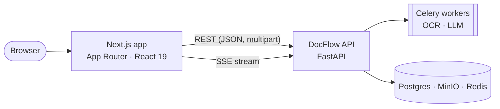

<div align="center">


# DocFlow

**Turn documents into answers.** The web app for DocFlow: upload PDFs, Word files and scans, then summarise them, extract invoice and contract data, or ask questions about them.

[](https://nextjs.org)
[](https://react.dev)
[](https://www.typescriptlang.org)
[](https://tailwindcss.com)
[](https://tanstack.com/query)

[Quick start](#quick-start) · [Features](#features) · [Architecture](#architecture) · [Configuration](#configuration) · [Development](#development)

</div>

---

DocFlow Frontend is a [Next.js](https://nextjs.org) App Router client for the **DocFlow API**, a FastAPI service that stores documents and runs OCR and AI processing in the background. This app handles sign-in, uploads with progress, live job tracking, streamed chat, and a dashboard of your usage. All processing happens in the API; the frontend talks to it over REST and Server-Sent Events.

> [!NOTE]
> This app needs a running DocFlow API. By default it expects one at `http://localhost:8000`. See [Configuration](#configuration).

## Quick start

```bash
git clone git@github.com:tuyishimehope/doc-flow-frontend.git
cd doc-flow-frontend
npm install
cp .env.example .env.local   # points the app at your DocFlow API
npm run dev
```

Open [http://localhost:3000](http://localhost:3000) and create an account.

> [!IMPORTANT]
> The API's CORS settings only allow `http://localhost:3000`, so run the dev server on that port.

## Features

| | |
| --- | --- |
| 📄 **Document processing** | Upload PDF, DOCX, JPEG, PNG or TIFF files and run a **summary**, **invoice extraction** or **contract metadata** job. Results appear as soon as the job finishes, and failed runs can be retried. |
| 💬 **Ask a document** | Ask questions about an indexed PDF and get answers that cite the page they came from. |
| 🤖 **Chat** | Streamed AI chat with saved conversations, image attachments and voice input. Replies render Markdown. |
| 📊 **Dashboard** | Count-up stats, a success-rate gauge, runs by mode, recent documents and failures, and AI activity per day over 7 or 30 days. |
| 🔐 **Accounts** | Sign up, log in, reset a forgotten password, edit your profile and change your password. |
| 🌗 **Light & dark** | Follows your system theme, with a royal-blue palette and motion that respects *reduce motion*. |

<details>
<summary><b>Screens at a glance</b></summary>

<br />

| Route | What it does |
| --- | --- |
| `/` | Landing page with an animated hero |
| `/login`, `/signup` | Sign in or create an account |
| `/forgot-password`, `/reset-password` | Email-based password reset |
| `/dashboard` | Overview of documents, runs and AI usage |
| `/documents` | Search, filter and archive your documents (`?q=` pre-fills the search) |
| `/documents/new` | Upload a file and choose what to do with it (`?mode=ask` for Q&A) |
| `/documents/[id]` | File preview, processing runs, results and the Ask panel |
| `/chat`, `/chat/[id]` | Conversations with the assistant |
| `/settings` | Profile, password and service status |

</details>

## Architecture



Every page that shows your data is a client component. Server state goes through **TanStack Query**: it caches responses and keeps polling while a job is queued or processing. The JWT is kept in `localStorage` and attached to every request by a single fetch wrapper.

<details>
<summary><b>Project structure</b></summary>

<br />

```text
app/
├── (auth)/              # login, signup, password reset + shared showcase layout
├── (app)/               # signed-in area, wrapped in the app shell
│   ├── dashboard/
│   ├── documents/       # list, upload (new/) and detail ([id]/)
│   ├── chat/            # conversation list + threads ([id]/)
│   └── settings/
├── _landing/            # landing-page sections and motion helpers
├── globals.css          # design tokens, light/dark themes, animations
├── icon.svg             # favicon
└── page.tsx             # landing page
components/              # app shell, UI primitives, chat, upload, result views
lib/
├── api.ts               # typed API client (fetch + XHR upload progress + SSE)
├── queries.ts           # TanStack Query hooks, cache keys and polling rules
├── sse.ts               # text/event-stream reader (POST + auth header)
├── types.ts             # API types
├── auth-store.ts        # token storage
└── use-*.ts             # auth, count-up and voice-recorder hooks
docs/
└── animation-script.md  # motion spec for the landing page
```

</details>

<details>
<summary><b>How the key flows work</b></summary>

<br />

- **Uploads** use `XMLHttpRequest` instead of `fetch`, so the progress bar can show real upload progress.
- **Processing runs** are polled by TanStack Query only while a run is `PENDING`, `QUEUED` or `PROCESSING`. Polling stops once the run finishes.
- **Chat streaming** posts to `/api/v1/chat/stream` and reads the response with a small SSE parser in `lib/sse.ts`. The browser's `EventSource` can't do this because it can't send a POST body or an `Authorization` header. Stopping a reply aborts the request.
- **Voice input** records with `MediaRecorder`, uploads the clip to `/api/v1/chat/transcribe`, and inserts the text into the message box.
- **Document Q&A** waits for the document's index to be ready, then calls `/api/v1/documents/{id}/ask`.
- **Auth guards** send signed-out users to `/login`, and signed-in users who open the auth pages to `/dashboard`.

</details>

## Tech stack

| Layer | Choice |
| --- | --- |
| Framework | [Next.js 16](https://nextjs.org) (App Router, Turbopack) |
| UI | [React 19](https://react.dev), [Tailwind CSS 4](https://tailwindcss.com), [lucide-react](https://lucide.dev) icons |
| Data | [TanStack Query 5](https://tanstack.com/query) |
| Content | [react-markdown](https://github.com/remarkjs/react-markdown) + [remark-gfm](https://github.com/remarkjs/remark-gfm) |
| Feedback | [sonner](https://sonner.emilkowal.ski) toasts |
| Fonts | Geist and Plus Jakarta Sans via `next/font` |

## Configuration

| Variable | Default | Description |
| --- | --- | --- |
| `NEXT_PUBLIC_API_URL` | `http://localhost:8000` | Base URL of the DocFlow API. A trailing slash is removed. |

<details>
<summary><b>Running the API locally</b></summary>

<br />

The backend lives in a separate repository (`doc_flow_backend`) and runs with Docker Compose. It brings up Postgres, Redis, MinIO, ClamAV and the Celery workers. The steps below are a short version; the backend README has the full setup.

```bash
cd ../doc_flow_backend
docker compose up -d
```

If uploads are rejected because the virus scanner is unavailable, start the ClamAV container again:

```bash
docker start docflow-clamav
```

The settings page shows each backend service's status, using `GET /health`.

</details>

## Development

```bash
npm run dev      # start the dev server on http://localhost:3000
npm run build    # production build
npm run start    # serve the production build
npm run lint     # ESLint
npx tsc --noEmit # type-check
```

<details>
<summary><b>Conventions</b></summary>

<br />

- **Next.js 16 APIs.** `params` and `searchParams` are Promises, and routes use the generated `PageProps<"/route">` and `LayoutProps` types. Check `node_modules/next/dist/docs/` before relying on older patterns.
- **Design tokens.** Use the semantic colours (`bg-surface`, `text-muted`, `border-line`, `bg-accent`, …) and the `brand-*` scale from `globals.css` rather than raw hex values, so light and dark mode both work.
- **Motion.** Add `lp-a` plus an animation class (`lp-rise`, `lp-fade`, `lp-grow`, …), then set timing with the `at(delay, duration)` helper. Every animation is turned off under `prefers-reduced-motion`.
- **API calls** go through `lib/api.ts` and are wrapped in a hook in `lib/queries.ts`. Components never call `fetch` directly.
- **Commits** follow [Conventional Commits](https://www.conventionalcommits.org) (`feat:`, `fix:`, `style:`, …).

</details>

<details>
<summary><b>Troubleshooting</b></summary>

<br />

| Symptom | Likely cause |
| --- | --- |
| Requests fail with a CORS error | The dev server isn't on port 3000, or `NEXT_PUBLIC_API_URL` points to the wrong host. |
| Uploads are rejected straight away | The API's ClamAV container is stopped. Run `docker start docflow-clamav`. |
| Jobs stay *Queued* | The Celery workers aren't running. Check `docker compose ps` in the backend. |
| You're sent to `/login` again and again | The token expired. Log in again (it's stored under `docflow.token` in `localStorage`). |

</details>

## Contributing

1. Create a branch from `main`.
2. Keep changes focused, and run `npm run lint` and `npx tsc --noEmit` before you push.
3. Open a pull request that describes what changed and includes screenshots for UI changes.

## License

No license file is included yet. Until one is added, treat this project as all rights reserved.
